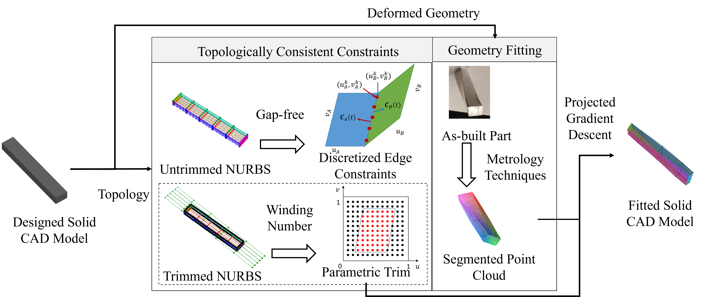
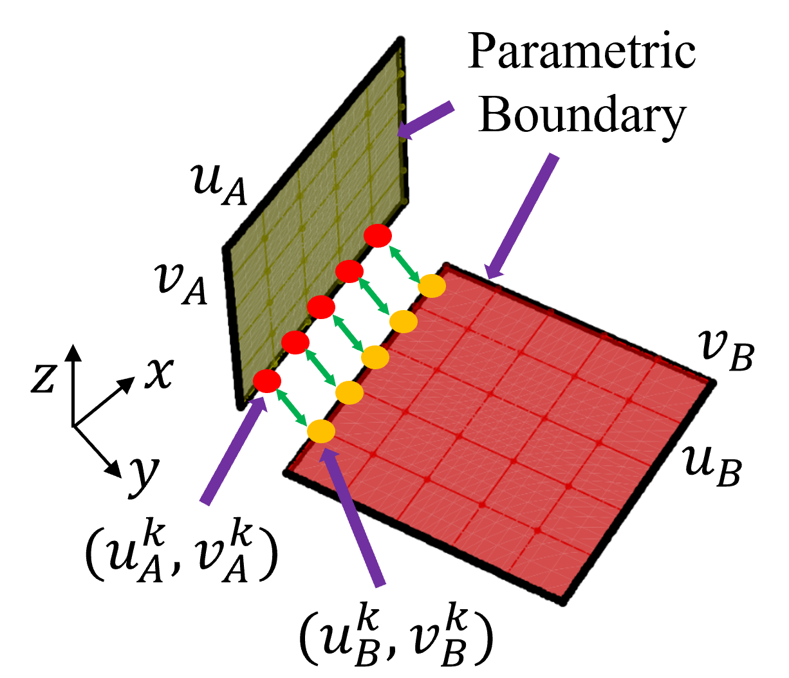
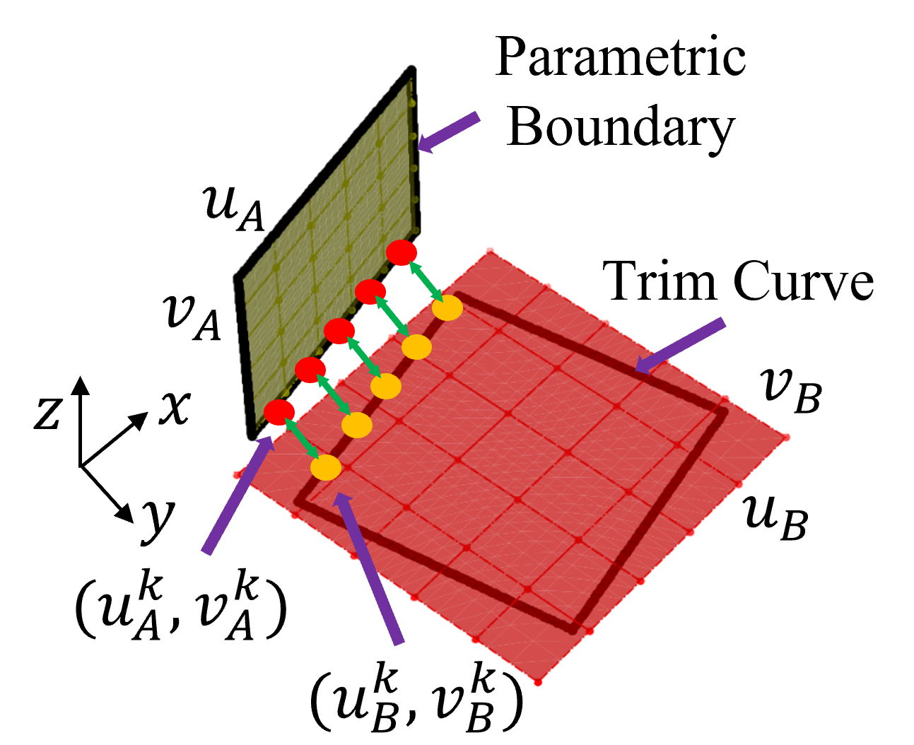
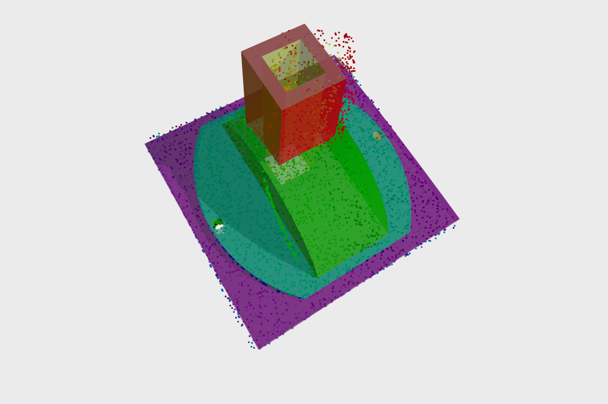
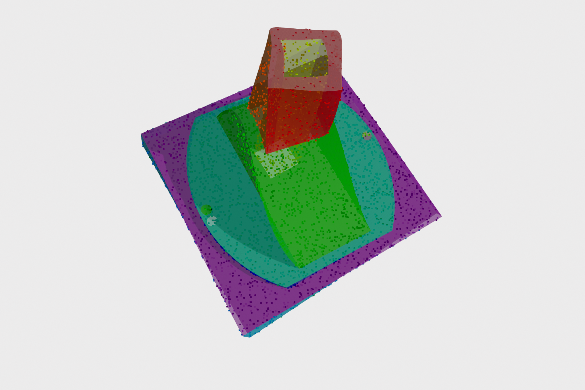

# CADMap — Topology-Preserving NURBS CAD Model Fitting

<p align="center">
  <a href="https://papers.ssrn.com/sol3/papers.cfm?abstract_id=4993462">
    
  </a>
  
  
  
</p>


---

<p align="center">
  
  <br>
  <em>CADMap deforms an as-designed NURBS CAD solid to match as-built point cloud measurements while preserving topology and producing a watertight, gap-free result.</em>
</p>

---

## About

Digital manufacturing increasingly relies on bidirectional mapping between as-designed CAD models and as-built part measurements obtained from CT scans, CMMs, or 3D scanners. However, manufacturing variability causes geometric inconsistency between these representations, making direct metrology-to-CAD alignment a persistent challenge — especially for complex multi-surface parts with trimmed NURBS geometries and large deformations.

We present **CADMap**, a framework that deforms an as-designed trimmed NURBS CAD solid to conform to the surface measurements of the as-built part. The core novelty lies in a new mathematical formulation of topology-preserving constraints: for each shared edge between adjacent NURBS surfaces, CADMap samples matched point pairs in geometric space and enforces their coincidence throughout the optimization. This allows constrained gradient descent to deform each surface freely toward the target point cloud while the constraint projection step prevents gaps or intersections from opening at surface junctions. The framework handles both untrimmed and trimmed NURBS patches by applying the winding-number algorithm to restrict the fitting loss to points inside each parametric trim boundary.

CADMap enables accurate, gap-free reconstruction of deformed CAD solids from point cloud data, directly supporting applications in in-situ monitoring, defect localization, and process control in manufacturing. By preserving the full parametric structure of the original STEP file, the fitted model provides an implicit bidirectional map between as-designed and as-built coordinate spaces — making it a practical building block for CAD-integrated digital twin workflows.

---

## Key Contributions

- **Topology-preserving constraint formulation** — discretized constraints enforce C0 continuity along shared edges in geometric space, preventing gaps when surfaces deform independently.
- **Trimmed NURBS support** — the winding-number algorithm restricts the fitting loss to the parametric interior of each trimmed surface patch.
- **Differentiable NURBS optimization** — GPU-accelerated NURBS evaluation via [NURBSDiff](https://github.com/idealab-isu/NURBSDiff) enables gradient-based fitting with a projected gradient descent optimizer.
- **Implicit bi-directional mapping** — the fitted model preserves the parametric structure of the original STEP file, enabling direct mapping between as-designed and as-built coordinates.

---

## Method

### Constraint formulation

For each shared edge, CADMap samples matched point pairs on adjacent surfaces and enforces their coincidence. The approach differs between untrimmed and trimmed surface configurations:

<p align="center">
  
  &nbsp;&nbsp;
  
  <br>
  <em>Left: constraints on untrimmed NURBS surfaces (boundary line segments in parametric space). Right: constraints on trimmed surfaces (NURBS trim curves in parametric space).</em>
</p>

### Results

<p align="center">
  
  &nbsp;&nbsp;
  
  <br>
  <em>Left: as-designed NURBS solid. Right: CADMap-fitted model conforming to the as-built point cloud.</em>
</p>

---

## Installation

### 1. Clone and install

```bash
git clone https://github.com/yourusername/cadmap.git
cd cadmap
pip install -e ".[dev]"
```

### 2. Manual dependencies

These packages are not available on PyPI and must be installed separately:

| Package | How to install |
|---|---|
| [pythonocc-core](https://github.com/tpaviot/pythonocc-core) | `conda install -c conda-forge pythonocc-core` |
| [NURBSDiff](https://github.com/idealab-isu/NURBSDiff) | `pip install git+https://github.com/idealab-isu/NURBSDiff.git` |
| [pytorch3d](https://github.com/facebookresearch/pytorch3d) | See [official install guide](https://github.com/facebookresearch/pytorch3d/blob/main/INSTALL.md) |

### 3. Verify

```python
import cadmap
print(cadmap.__version__)  # 0.1.0
```

---

## Quick Start

```python
from cadmap.conversion.occ import SolidConvertor, add_geom_to_solid, create_diffsurf_of_solid
from cadmap.deformation.fitting import CADMapOptimizer
from cadmap.visualization.plots import write_step

# 1. Load the as-designed CAD model from a STEP file
solid = SolidConvertor("my_part.step").convert()
add_geom_to_solid(solid)
create_diffsurf_of_solid(solid, device="cuda")

# 2. Provide one point-cloud array per surface (pre-segmented)
#    targets[i] has shape (N_i, 3)
targets = [...]  # list of np.ndarray

# 3. Run the optimizer
optimizer = CADMapOptimizer(
    solid,
    targets=targets,
    device="cuda",
    lr=10.0,
    n_epochs=1000,
)
optimizer.run()

# 4. Export the fitted solid
fitted_solid = optimizer.export_occ_solid()
write_step(fitted_solid, "fitted.step")
```

---

## Pipeline

```
as-designed STEP file
        │
        ▼
SolidConvertor  ──► Topology tree (Solid → Face → Wire → Edge → Vertex)
        │
        ▼
add_geom_to_solid  ──► attach BsplineSurface / Curve2d / Curve3d geometry
        │
        ▼
build_constraint_matrix  ──► (R × K) matrix encoding C0 edge continuity
        │
        ▼
CADMapOptimizer.run()
   ├─ per-vertex loop: project gradient to null space of active constraints
   ├─ loss = Σ Chamfer(surface_i, target_i)
   └─ scheduler: MultiStepLR, halved every 1 000 epochs
        │
        ▼
export_occ_solid  ──► watertight trimmed NURBS STEP file
```

---

## Point Cloud Preparation

Point clouds are expected to be pre-segmented by surface.
We used **CloudCompare (v2.10.3)** for manual registration and segmentation of CT/scan data.
Each `targets[i]` array should contain the points belonging to the *i*-th face of the
STEP file (in face order from `solid.descendent`).

---

## Package Structure

```
src/cadmap/
├── geometry/          # BsplineSurface, Curve2d, Curve3d, Topology
├── conversion/        # SolidConvertor, STEP I/O, OCC helpers
├── sampling/          # sample_points_from_solid, generate_point_cloud_from_step
├── deformation/       # CADMapOptimizer, constraint matrix, mesh utils
├── registration/      # surface matching (Hungarian), geometric inversion
├── metrics/           # Chamfer and Hausdorff distances
├── visualization/     # Matplotlib + Open3D plotting, write_step
└── _internal/         # winding number, math helpers
```

---

## Documentation

```bash
pip install -e ".[dev]"
mkdocs serve        # opens at http://127.0.0.1:8000
```

---

## Citation

If you find our work useful in your research, please consider citing:

```bibtex
@article{liu2024cadconform,
  title   = {Reconstruction of deformed trimmed {NURBS} solid models using a reference {CAD} topology},
  author  = {Liu, Lijie and Shen, Weijun and Zhang, Zhan and Holland, Stephen D. and Li, Qing and Krishnamurthy, Adarsh},
  year    = {2024},
  note    = {Preprint available at SSRN: \url{https://papers.ssrn.com/sol3/papers.cfm?abstract_id=4993462}}
}
```

---

## License

MIT — see [LICENSE](LICENSE) for details.

---

## Acknowledgements

This work builds on [NURBSDiff](https://github.com/idealab-isu/NURBSDiff) for differentiable NURBS evaluation and [pythonocc-core](https://github.com/tpaviot/pythonocc-core) (OpenCASCADE) for B-Rep topology and STEP I/O.
